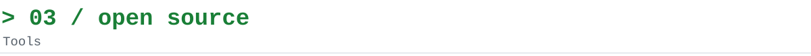
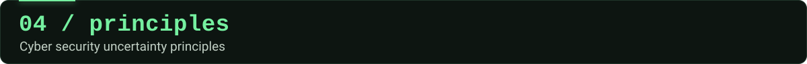

  &nbsp;
  &nbsp;
  

> I think that loving security means loving knowledge.

I am Head of Application Security at Cedacri. I work to integrate security into the software development lifecycle and the design of complex systems. My background combines hands-on security assessments with architecture, security guidelines and support for development teams.

I have worked in banking and automotive environments on topics including SSDLC, authentication, risk analysis, embedded systems security and vulnerability assessment. Technical writing and open-source tool development are also part of my work.

`20+ years of experience` `Banking & Automotive` `SSDLC and AppSec` `Technical author`

**[Cyber Security: Social Engineering](https://www.amazon.it/dp/B0HM6V8T8J)**  
`2026 · Volume 3 · 214 pages`  
Social engineering treated as a technical discipline, along the first five phases of the Cyber Kill Chain.

**[Cyber Security: Post-Exploitation](https://www.amazon.it/dp/B0HG9572N3/)**  
`2026 · Volume 2 · 290 pages`  
How an attacker extends control over a network after compromising a single machine: privilege escalation and pivoting, with real Kali Linux commands.

**[Cyber Security: Guida pratica ai segreti dell’hacking etico nel 2025](https://www.amazon.it/dp/B0F9NBKF16)**  
`2025 · Volume 1 · 513 pages`  
Real, ready-to-use Kali Linux commands, with theory kept to a minimum.

Articles: [Penetration Test, Black Box Type](https://www.slideshare.net/slideshow/penetration-test-black-box-type/52804207) (2015) · [Integrated Malware Analysis](https://pentestmag.com/download/secure-coding-pentest-regular-022014-teaser/) (2014) · [Assembly and Reverse Engineering](https://www.slideshare.net/slideshow/assembly-and-reverse-engineering/28972347) (2013)

Open-source tools and lab material, grouped by topic. Everything here is meant for lab environments and authorized security testing: use it only on systems you own or are explicitly allowed to test.

#### Web and recon

| Repository | What it does |
| --- | --- |
| [SiteSniper](https://github.com/dokDork/SiteSniper) | Bash script to automate the penetration test. |
| [odd-Header-Hunter](https://github.com/dokDork/odd-Header-Hunter) | For bug bounty on wildcard domains: extracts all the subdomains of the target and the odd headers of each domain. |
| [webDataExtractor](https://github.com/dokDork/webDataExtractor) | Explores all the pages of a website and extracts emails, usernames, HTML comments, telephone numbers and links. |
| [fromWord2Site](https://github.com/dokDork/fromWord2Site) | Builds a list of site names starting from a list of words. |
| [Dork2Sqlmap](https://github.com/dokDork/Dork2Sqlmap) | Lets you select Google dorks related to SQL injection and generates ready-to-use sqlmap commands, for authorized security testing and bug bounty. |
| [LFIxplorer](https://github.com/dokDork/LFIxplorer) | Exploits Local File Inclusion vulnerabilities: it identifies vulnerable parameters and reads files on the server. For authorized web application tests. |
| [CommandInjectionShield](https://github.com/dokDork/CommandInjectionShield) | Prepares precompiled tmux sessions to test command injection on the parameters of a web page (GET or POST). |
| [jwks-converter](https://github.com/dokDork/jwks-converter) | Converts the RSA public key parameters (n and e) of a JWKS JSON file into a PEM public key. |

#### Network and wireless

| Repository | What it does |
| --- | --- |
| [DNSWatchdog](https://github.com/dokDork/DNSWatchdog) | Analyzes the TCP and UDP packets captured by a Wireshark session during a DNS spoofing attack, to see which hostnames and ports the target tries to reach. |
| [AP-gateway](https://github.com/dokDork/AP-gateway) | Creates a proxy access point on a Linux machine. The traffic that passes through it can be analyzed or diverted to other proxies, such as Burp Suite, mitmproxy or certmitm. |
| [AP-captive](https://github.com/dokDork/AP-captive) | Creates a passwordless access point. Connecting users are still prompted for a password, which the access point saves. For lab demonstrations and authorized wireless tests. |

#### Shells, backdoors and exploitation labs

| Repository | What it does |
| --- | --- |
| [backdoor-playground](https://github.com/dokDork/backdoor-playground) | A lab playground for studying reverse shells: a C client that connects back to your server, paired with a Python interception server that monitors the calls. |
| [revParty](https://github.com/dokDork/revParty) | Trojan and backdoor generator, for lab environments and authorized red team exercises. |
| [revShellAndroid](https://github.com/dokDork/revShellAndroid) | Reverse shell in smali code for Android, for lab use and authorized mobile security tests. |
| [reverseEngineering](https://github.com/dokDork/reverseEngineering) | A training environment: vulnerable target applications and the Python scripts used to exploit them and obtain a reverse shell. |
| [Heapy](https://github.com/dokDork/Heapy) | Gets credentials from the heap memory of running processes, for lab work and authorized tests. |

#### Utilities

| Repository | What it does |
| --- | --- |
| [tools](https://github.com/dokDork/tools) | A small toolbox of useful bash scripts. |
| [factLens](https://github.com/dokDork/factLens) | Evaluates the truthfulness of statements. |
| **[All repositories](https://github.com/dokDork?tab=repositories)** | The full list of repositories on GitHub. |

Cyber security offers few certainties. Below I have tried to summarize some uncertainty principles that I have experienced in real life:

- **First principle**: there is no upper limit to the amount of security that can be applied to a system.
- **Second principle**: no matter how much security has been inserted into a system, the system will still be hackable.
- **Third principle**: time erodes the security of a system.

**So what can we do?**

To make a system secure you must get as much information as possible about that system, you must analyze it from many points of view trying to understand how to change its predefined behavior. Hacking is a methodology that allows you to analyse systems more deeply than most people can.  
Hacking requires you to increase your knowledge every day.  
So start now: read, experiment, verify the results, correct your beliefs, learn new things and start again, broadening the field of your knowledge each time.

For professional collaborations, consulting, speaking engagements or further information, you can reach me on [LinkedIn](https://www.linkedin.com/in/luigi-capuzzello/) or through [my website](https://capuzzello.altervista.org/).
